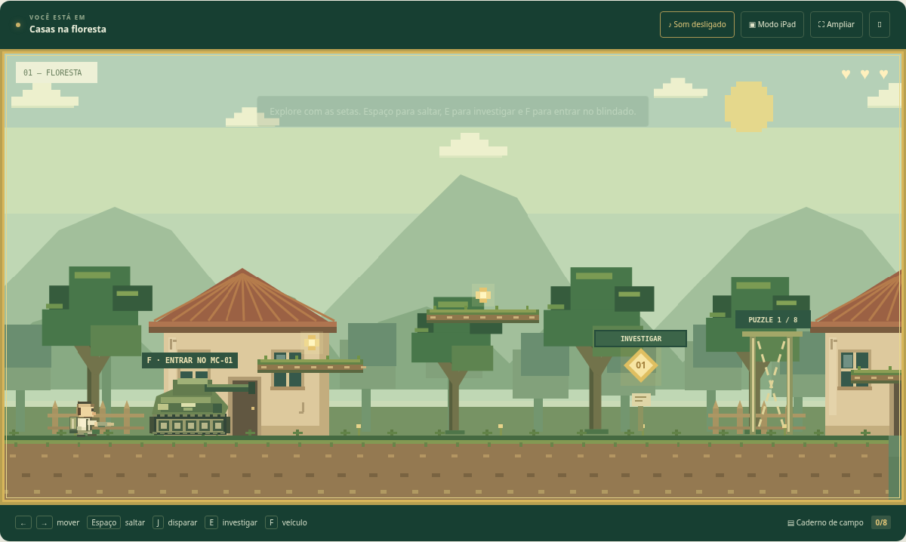

# Missão Chagas — O caminho da descoberta

Jogo educativo de plataforma com oito investigações sobre a doença de Chagas, cenário em pixels e um blindado pilotável.

Esta versão foi reconstruída a partir da gravação fornecida, usando como referência o cenário de floresta, as plataformas, o personagem e a janela de investigação. A gravação não fornece o código nem todos os cenários do site original.



## Jogar no computador

Baixe o repositório em **Code → Download ZIP**, extraia a pasta inteira e abra `index.html`. Mantenha os arquivos JavaScript e CSS ao lado dele. Os controles e as instruções estão em `LEIA-ME.txt`.

## Servir localmente

Sem dependências de instalação:

```sh
python3 -m http.server 8000
```

## GitHub Pages

O projeto é estático. Em **Settings → Pages**, escolha **Deploy from a branch**, branch **main**, pasta **/(root)** e salve. Aguarde o GitHub confirmar o término da publicação antes de usar o endereço exibido pelo serviço.

## Conteúdo

Transmissão por ordenação de etapas, outras vias, sinal clínico, investigação de caso, diagnóstico, prevenção e políticas públicas, tratamento e conclusão. As explicações educativas diferenciam o cuidado em saúde dos elementos de fantasia do jogo.
